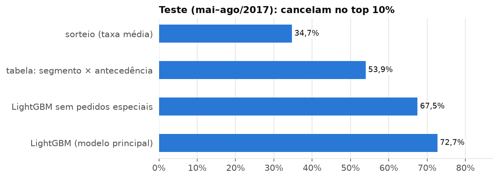
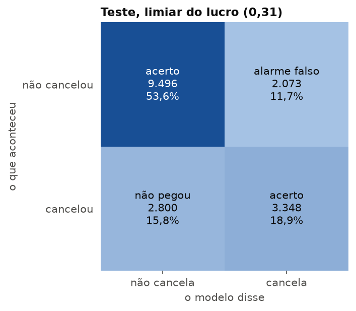
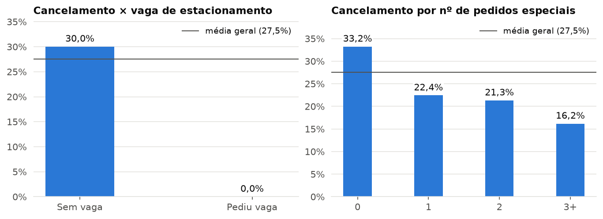
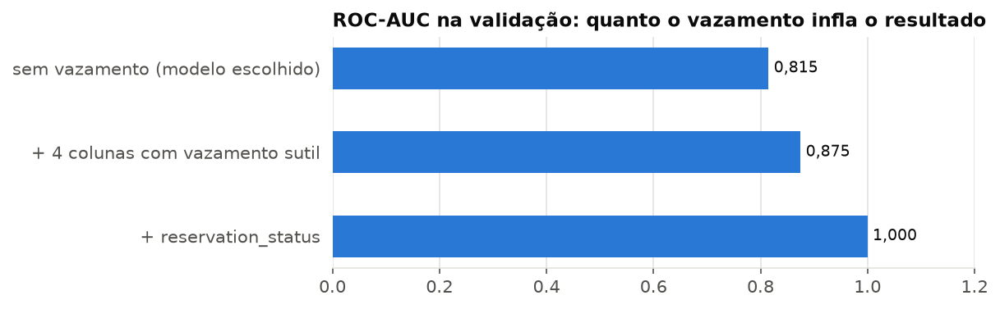
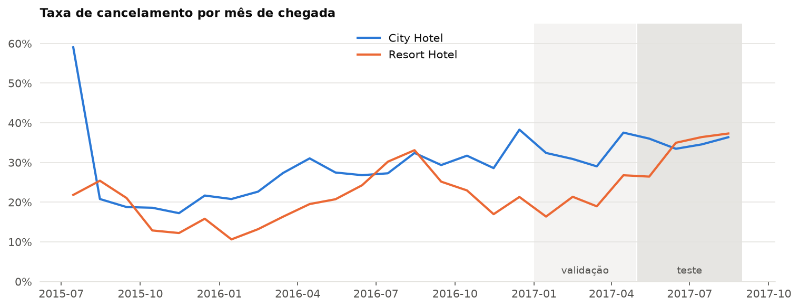
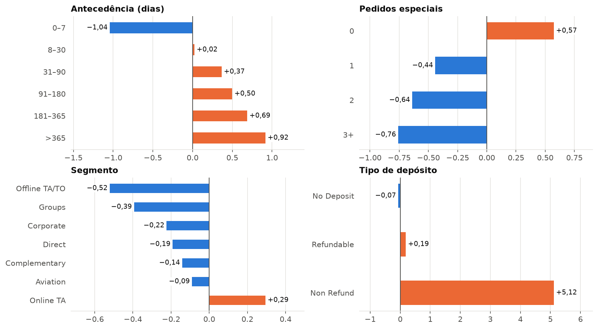

# Previsão de cancelamento de reservas de hotel

Modelo que estima, no momento da reserva, a chance de ela ser cancelada. O uso pensado: o hotel saber para quais reservas vale a pena ligar antes da chegada.

*[English version](README.en.md)*

## Resultado

No período de teste (chegadas de maio a agosto de 2017, que não foi usado para treinar nem para escolher nada):

- Das 10% reservas que o modelo aponta como mais arriscadas, **67% a 73% cancelam de fato**. Escolhendo ao acaso seriam 35%, e com uma tabela simples de segmento × antecedência, 54%.
- ROC-AUC de **0,765** (0,745 na versão conservadora).
- Taxa de acerto (acurácia) de **72,5%**, com precisão de 62% e recall de 55%. Detalhes e ressalvas em [Taxa de acerto](#taxa-de-acerto).
- O que mais pesa: antecedência da reserva, pedidos especiais, agência e segmento de mercado.



O resultado é dado como intervalo (67% a 73%) por causa de uma variável com ressalva, explicada em [Limitações](#limitações).

## Taxa de acerto

Para medir acerto, a probabilidade vira sim ou não com um limiar e a previsão é comparada com o que aconteceu. No teste:

| | Acurácia | Precisão | Recall | F1 |
|---|---|---|---|---|
| Chutar que nenhuma reserva cancela | 65,3% | – | 0% | 0 |
| Chutar que todas cancelam | 34,7% | 34,7% | 100% | 0,52 |
| LightGBM, limiar padrão 0,5 | 72,7% | 67,9% | 40,2% | 0,51 |
| **LightGBM, limiar do lucro 0,31 (oficial)** | **72,5%** | **61,8%** | **54,5%** | **0,58** |
| LightGBM, limiar de maior F1 0,26 | 71,4% | 58,2% | 62,8% | 0,60 |

- **A acurácia engana sozinha.** 72,5% parece alto, mas chutar que ninguém cancela já acerta 65,3%, porque a maioria das reservas não cancela. O ganho real em acurácia é de uns 7 pontos.
- **Precisão e recall dizem mais:** das reservas que o modelo marca como risco, 62% cancelam; dos cancelamentos que aconteceram, ele pega 55%.
- **O limiar padrão 0,5 é uma escolha ruim aqui:** pega só 40% dos cancelamentos, e o F1 fica abaixo do chute de que todas cancelam. Cada métrica aponta para um limiar diferente; o oficial foi escolhido pelo lucro (ver [Decisão](#decisão-para-quem-ligar)), e todos os limiares foram escolhidos na validação.



## Dados

[Hotel Booking Demand](https://www.kaggle.com/datasets/jessemostipak/hotel-booking-demand) (Kaggle): 119.390 reservas de dois hotéis em Portugal, um urbano em Lisboa e um resort no Algarve, com chegadas de julho de 2015 a agosto de 2017. Fonte original: Antonio, Almeida e Nunes (2019), *Hotel booking demand datasets*, Data in Brief 22.

## O que ficou de fora e por quê

Para cada coluna, a pergunta foi: essa informação já existe no dia da reserva? Seis colunas não passaram, porque só são preenchidas depois (no check-in ou no cancelamento) e entregariam a resposta ao modelo.

| Coluna | Por que sai |
|---|---|
| `reservation_status`, `reservation_status_date` | São a própria resposta: o status final e a data do cancelamento ou da saída |
| `assigned_room_type` | O quarto é definido no check-in. Quarto diferente do reservado quase sempre significa que o hóspede apareceu |
| `booking_changes` | Conta as alterações até o check-in ou o cancelamento |
| `country` | As canceladas ficam com Portugal como valor padrão: em 2015, 96% das reservas canceladas estão como Portugal, contra 39% das que fizeram check-out |
| `required_car_parking_spaces` | Quem pediu vaga cancela exatamente 0%. A vaga é registrada na chegada |



Mantendo as quatro colunas de vazamento mais discretas, o ROC-AUC na validação subiria de 0,815 para 0,875. Com `reservation_status`, chegaria a 1,0. O número fica melhor, mas o modelo estaria usando informação que não existe no momento em que ele seria usado.



Também saíram 31.980 linhas idênticas (quartos de uma mesma reserva de grupo, sem ID para diferenciar; mantidas, poucos grupos grandes dominariam o treino) e 198 registros sem sentido, como diária negativa e reserva sem hóspedes.

## Como foi feito

**1. Separação por data, não aleatória.** Treino com chegadas de jul/2015 a dez/2016, validação de jan a abr/2017 e teste de mai a ago/2017. A taxa de cancelamento sobe com o tempo (25% no treino, 28% na validação, 35% no teste), e a separação por data mostra como o modelo se sai num período que ele nunca viu.



**2. Pontos de comparação antes de qualquer modelo:** escolher ao acaso, uma regra só com a antecedência e uma tabela com a taxa de cancelamento por segmento × faixa de antecedência.

**3. Modelos:** regressão logística, random forest e LightGBM, com o mesmo preparo dentro de um `Pipeline` do scikit-learn. O LightGBM foi escolhido na validação. O ajuste de parâmetros mudou o ROC-AUC em menos de 0,005, então ficou a configuração original.

| Modelo | ROC-AUC validação | ROC-AUC teste | Cancelam no top 10%, validação | Cancelam no top 10%, teste |
|---|---|---|---|---|
| Ao acaso | 0,500 | 0,500 | 28,4% | 34,7% |
| Tabela segmento × antecedência | 0,735 | 0,675 | 55,6% | 53,9% |
| Regressão logística | 0,790 | | 74,5% | |
| Random forest | 0,812 | | 72,9% | |
| LightGBM sem pedidos especiais | 0,789 | 0,745 | 65,6% | 67,5% |
| **LightGBM (modelo final)** | **0,815** | **0,765** | **74,1%** | **72,7%** |

**4. Explicação.** Valores SHAP somados por variável. As direções fazem sentido para o negócio: reservas feitas com muita antecedência, sem pedidos especiais e vindas de agências online cancelam mais. O depósito `Non Refund` tem efeito forte porque, nesta base, ele marca bloqueios de quartos de grupos e operadoras, que são cancelados quando não são preenchidos.



**5. Teste:** usado uma vez só, com modelo, limiar e cenário de custo decididos antes.

## Decisão: para quem ligar

O modelo dá uma probabilidade, mas o hotel precisa de um sim ou não. Cenário usado (uma suposição, para ser trocada pelos números reais do hotel): contatar a reserva com um incentivo para confirmar custa €30, e quando a reserva ia cancelar o contato recupera 25% do valor dela (diária × noites).

- **Na validação**, o melhor corte foi 0,31: contatar 31% das reservas, com lucro de €141 mil em quatro meses. Contatar todo mundo daria prejuízo de €35 mil.
- **No teste, esse corte fixo não funcionou:** deu €423 mil, menos que contatar todo mundo (€451 mil). No verão as reservas valem quase o dobro (€561 contra €313 na validação) e cancelam mais, então o contato compensa até nas reservas de risco baixo.
- **Aprendizado** (análise feita depois de ver o teste, por isso não é o resultado oficial): uma regra tirada direto do cenário de custo, contatar quando *probabilidade × 25% × valor da reserva > €30*, ganha nos dois períodos (€166 mil na validação e €569 mil no teste) e se ajusta sozinha à temporada. É a recomendação para uma próxima versão.

## Limitações

- **Pedidos especiais** é a variável mais importante e pode incluir pedidos feitos depois da reserva, perto da chegada, por quem de fato vai aparecer. Os dados não permitem confirmar. Sem ela, o resultado no teste cai de 73% para 67% no top 10%, por isso o resultado é dado como intervalo.
- O modelo acerta a ordem (quem é mais arriscado), mas subestima o nível do risco quando a taxa de cancelamento sobe: previu 28,8% em média no teste, e o real foi 34,7%. Em uso real, precisaria de retreino periódico.
- São dois hotéis em Portugal, de 2015 a 2017. Para outro hotel, o modelo teria que ser treinado de novo.
- O cenário de custo é suposto. A base não informa a moeda; os valores foram tratados como euro.

## Como rodar

Python 3.11. Com [uv](https://docs.astral.sh/uv/):

```bash
uv venv --python 3.11
uv pip install -r requirements.txt
```

Ou com pip: `python -m venv .venv` e `pip install -r requirements.txt`.

Baixe `hotel_bookings.csv` do [Kaggle](https://www.kaggle.com/datasets/jessemostipak/hotel-booking-demand), coloque em `data/raw/` e rode os notebooks em ordem:

| Notebook | O que faz |
|---|---|
| `notebooks/01_dados_eda.ipynb` | Limpeza, duplicadas, auditoria de vazamento e análise exploratória. Salva a base limpa |
| `notebooks/02_separacao.ipynb` | Separa treino, validação e teste por data |
| `notebooks/03_modelos.ipynb` | Pontos de comparação, modelos e escolha. Mede quanto o vazamento inflaria o resultado |
| `notebooks/04_decisao_e_teste.ipynb` | Limiar pelo custo, explicação com SHAP, resultado no teste e taxa de acerto (acurácia, precisão, recall, F1) |

`notebooks/graficos.py` e `notebooks/avaliacao.py` têm as funções de gráfico e as métricas usadas pelos notebooks.

## Autor

Caio Goia · [LinkedIn](https://www.linkedin.com/in/caio-goia) · [GitHub](https://github.com/caiogoia123)
